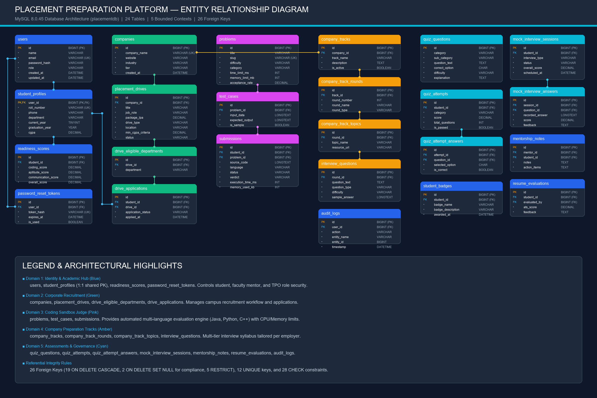
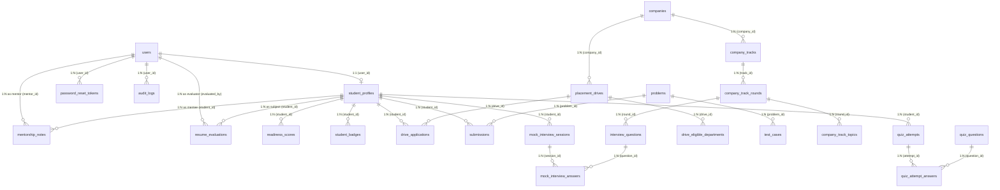

# Placement Preparation Platform — Database Engine (`placementdb`)

[](https://www.mysql.com/)
[]()
[]()
[]()
[]()
[]()

A relational database engineering project developed for an enterprise **Placement Preparation and Campus Recruitment Platform**. 

This repository contains the standalone, production-ready MySQL database schema (`placementdb`), seed data, analytical queries, entity-relationship models, and documentation. It can be deployed directly on any MySQL 8.0+ server or cloud database service (Amazon RDS, Google Cloud SQL, Azure Database for MySQL).

> 🎬 **Live Interactive Video Presentation (10 Minutes with AI Voiceover):**  
> 👉 **[Watch & Listen Live on GitHub Pages](https://HemaPavanManikanta.github.io/Sql_Codegnan_project/video_presentation/)**  
> *(Includes 10 synchronized HD slides, full AI narration tracks, live closed captions, and navigation controls)*

---

## 📑 Table of Contents
1. [Project Overview](#-project-overview)
2. [Key Database Features](#-key-database-features)
3. [Technology Stack](#-technology-stack)
4. [Entity-Relationship (ER) Diagram](#-entity-relationship-er-diagram)
5. [Database Architecture & 5 Bounded Contexts](#-database-architecture--5-bounded-contexts)
6. [Data Integrity & Constraints](#-data-integrity--constraints)
7. [Repository Structure](#-repository-structure)
8. [Setup & Installation](#-setup--installation)
9. [Environment Configuration](#-environment-configuration)
10. [Analytical Queries & Reporting](#-analytical-queries--reporting)
11. [Team Member Contributions](#-team-member-contributions)
12. [License](#-license)

---

## 🎯 Project Overview

Higher education placement cells and university training departments face immense challenges in tracking student readiness, managing corporate hiring drives, administering multi-language coding assessments, and providing personalized faculty mentorship.

`placementdb` resolves these problems through a normalized relational architecture partitioned into **5 distinct bounded domains**:
- **Identity & Academic Hub:** Role-based access control (`STUDENT`, `MENTOR`, `TPO`) and academic profiles (`CGPA`, `department`, `graduation_year`).
- **Recruitment Lifecycle:** Corporate partner directory, drive listings, departmental branch eligibility, and student application pipelines.
- **Coding Assessment Engine:** Competitive programming problem repository, test suites (sample vs. hidden), and execution submission judge.
- **Company Preparation Tracks:** Multi-round hiring roadmaps (OA, Technical, HR), round topics, and curated question banks.
- **Assessments, Mocks & Governance:** Timed MCQ quizzes, AI/Faculty mock interview session rubrics, faculty mentorship notes, student achievement badges, and immutable audit logs.

---

## ⚡ Key Database Features

- **24 Relational Tables / 185 Columns:** Strict data typing, zero untyped columns, and explicit nullability.
- **1:1 Shared Primary Key:** `student_profiles` shares `user_id` as its primary key with `users.id`, ensuring strict academic entity integrity.
- **26 Referential Constraints:** Complete lifecycle management with 19 `ON DELETE CASCADE` rules, 2 `ON DELETE SET NULL` compliance guards, and 5 `RESTRICT` safety locks.
- **28 Database-Level Check Constraints:** Enforces business logic (e.g., scores `0.00 - 100.00`, CGPA `0.00 - 10.00`, academic year `1 - 4`, and strict role enumerations) inside the database engine.
- **12 Unique Constraints:** Prevents duplicate accounts, duplicate drive applications (`uq_student_drive`), duplicate badges, and repeated quiz attempt entries.
- **High Concurrency & ACID Guarantees:** Designed specifically for MySQL's **InnoDB** storage engine with row-level locking, B-tree covering indexes, and foreign key verification.

---

## 🛠 Technology Stack

| Component | Technology / Tool | Specification |
|---|---|---|
| **RDBMS Engine** | MySQL Server | Version 8.0.45 Community / Enterprise |
| **Storage Engine** | InnoDB | Full ACID compliance, foreign key cascade support |
| **Character Set & Collation** | `utf8mb4` / `utf8mb4_unicode_ci` | Multilingual support, emoji and code character safety |
| **Client / Admin Tools** | MySQL Workbench / DBeaver / CLI | Compatible with standard SQL-92 / SQL:2016 standards |
| **Backend Integration** | Spring Boot 3.x / Hibernate JPA | Entities synchronize with DDL definitions |
| **Data Format** | Standard SQL Script (`.sql`) | Clean DDL creation, drop sequence, and seed data |

---

## 📊 Entity-Relationship (ER) Diagram

The high-resolution architectural diagram illustrates the relational links across all 24 database tables:



### Mermaid Diagram Representation


---

## 🏛 Database Architecture & 5 Bounded Contexts

| Domain | Table Name | Columns | Primary Key | Key Relationships |
|---|---|:---:|---|---|
| **1. Identity & Student Hub** | `users` | 7 | `id` (AUTO_INCREMENT) | Root identity table; roles: `STUDENT`, `MENTOR`, `TPO` |
| | `student_profiles` | 7 | `user_id` | Shared 1:1 PK linked to `users(id)`; stores academic metadata |
| | `readiness_scores` | 7 | `id` (AUTO_INCREMENT) | 1:N with student; tracks coding, aptitude, communication |
| | `password_reset_tokens`| 6 | `id` (AUTO_INCREMENT) | 1:N with users; SHA-256 hashed recovery tokens |
| **2. Recruitment Lifecycle** | `companies` | 7 | `id` (AUTO_INCREMENT) | Corporate hiring partners catalog (`company_name` UNIQUE) |
| | `placement_drives` | 11 | `id` (AUTO_INCREMENT) | 1:N with companies; hiring drives, packages, CGPA cutoff |
| | `drive_eligible_departments`| 3 | `id` (AUTO_INCREMENT) | 1:N with drives; maps eligible branches (e.g. CSE, IT, ECE) |
| | `drive_applications` | 6 | `id` (AUTO_INCREMENT) | Junction table mapping students to drives with composite UNIQUE |
| **3. Coding Judge Sandbox** | `problems` | 11 | `id` (AUTO_INCREMENT) | Problem catalog; slug UNIQUE, difficulty, time/memory limits |
| | `test_cases` | 6 | `id` (AUTO_INCREMENT) | 1:N with problems; holds sample and hidden test case data |
| | `submissions` | 10 | `id` (AUTO_INCREMENT) | Evaluated student code submissions and verdicts |
| **4. Company Tracks** | `company_tracks` | 7 | `id` (AUTO_INCREMENT) | 1:N with companies; company-specific preparation paths |
| | `company_track_rounds` | 6 | `id` (AUTO_INCREMENT) | 1:N with tracks; hiring stages (OA, Technical, HR) |
| | `company_track_topics` | 5 | `id` (AUTO_INCREMENT) | 1:N with rounds; syllabus topics (e.g. DP, Graphs, OOPs) |
| | `interview_questions` | 7 | `id` (AUTO_INCREMENT) | 1:N with rounds; curated questions and sample answers |
| **5. Assessments & Governance** | `quiz_questions` | 12 | `id` (AUTO_INCREMENT) | Multiple-choice questions for aptitude and core CS |
| | `quiz_attempts` | 8 | `id` (AUTO_INCREMENT) | Timed quiz sessions per student |
| | `quiz_attempt_answers` | 7 | `id` (AUTO_INCREMENT) | Selected options per question; composite UNIQUE guard |
| | `mock_interview_sessions`| 12 | `id` (AUTO_INCREMENT) | AI/Peer/Faculty mock interview lifecycle |
| | `mock_interview_answers` | 9 | `id` (AUTO_INCREMENT) | Recorded answers and rubric feedback per question |
| | `mentorship_notes` | 8 | `id` (AUTO_INCREMENT) | 1:1 counseling records joining mentors with students |
| | `resume_evaluations` | 9 | `id` (AUTO_INCREMENT) | ATS score & rubric evaluations (SET NULL on evaluator deletion) |
| | `student_badges` | 6 | `id` (AUTO_INCREMENT) | Achievement badges awarded to students |
| | `audit_logs` | 8 | `id` (AUTO_INCREMENT) | Administrative audit log (SET NULL protects history) |

---

## 🛡 Data Integrity & Constraints

### 1. Primary Key Design
- **23 Surrogate Keys:** `BIGINT UNSIGNED AUTO_INCREMENT` ensures efficient 64-bit B-tree balancing and fast joins.
- **1 Shared Primary Key:** `student_profiles.user_id` enforces an exact 1:1 relationship with `users.id`, eliminating redundant surrogate keys.

### 2. Check Constraints (28 Rules)
- **Role Validity:** `users.role IN ('STUDENT', 'MENTOR', 'TPO')`
- **Academic Validations:** `student_profiles.current_year BETWEEN 1 AND 4` and `cgpa BETWEEN 0.00 AND 10.00`
- **Metric Boundaries:** All sub-scores in `readiness_scores` and `resume_evaluations` bounded between `0.00` and `100.00`
- **Status Lifecycles:** `placement_drives.status IN ('UPCOMING', 'ACTIVE', 'COMPLETED', 'CANCELLED')`

### 3. Business Deduplication (12 Unique Keys)
- `users(email)`: Login credential uniqueness.
- `student_profiles(roll_number)`: Institutional registration uniqueness.
- `drive_applications(student_id, drive_id)`: Prevents duplicate applications to the same recruitment drive.
- `company_tracks(company_id, track_name)`: Enforces unique track names per corporate partner.
- `company_track_rounds(track_id, round_number)`: Enforces sequential round numbering without duplicates.
- `quiz_attempt_answers(attempt_id, question_id)`: Prevents multiple recorded answers per question in a quiz session.

---

## 📁 Repository Structure

```
database_sql/
├── README.md                          # Comprehensive project documentation
├── diagrams/
│   └── er_diagram.png                 # High-resolution Entity-Relationship diagram
├── sql/
│   ├── 01_schema_ddl.sql              # Complete DDL script (24 tables, FKs, check constraints)
│   ├── 02_seed_data.sql               # Realistic demonstration & testing seed data
│   └── 03_analytical_queries.sql      # 5 complex analytical & business reporting queries
└── docs/
    ├── DATABASE_CONSTRAINTS.md        # Detailed breakdown of all PK, FK, UQ, and Check constraints
    ├── DATABASE_INVENTORY.md          # 24-table column-level data dictionary (185 columns)
    └── DATABASE_RELATIONSHIPS.md      # Foreign key reference matrix & architectural rules
```

---

## 🚀 Setup & Installation

### Prerequisites
- MySQL Server 8.0 or higher
- MySQL Command Line Client or GUI (MySQL Workbench, DBeaver)

### Execution Steps

1. **Clone the Repository:**
   ```bash
   git clone https://github.com/<your-username>/database_sql.git
   cd database_sql
   ```

2. **Log into MySQL:**
   ```bash
   mysql -u root -p
   ```

3. **Execute Schema Creation DDL:**
   ```sql
   SOURCE sql/01_schema_ddl.sql;
   ```

4. **Load Sample Seed Data:**
   ```sql
   SOURCE sql/02_seed_data.sql;
   ```

5. **Run Analytical Queries:**
   ```sql
   SOURCE sql/03_analytical_queries.sql;
   ```

6. **Verify Installation:**
   ```sql
   USE placementdb;
   SHOW TABLES;
   SELECT table_name, table_rows 
   FROM information_schema.tables 
   WHERE table_schema = 'placementdb';
   ```

---

## ⚙ Environment Configuration

If integrating this database into a backend application (Spring Boot, Node.js, Django, or FastAPI), use the following configuration settings:

### `.env` File Example
```env
DB_HOST=localhost
DB_PORT=3306
DB_NAME=placementdb
DB_USER=root
DB_PASSWORD=your_secure_password
DB_CHARSET=utf8mb4
DB_TIMEZONE=UTC
```

### Spring Boot `application.properties`
```properties
spring.datasource.url=jdbc:mysql://localhost:3306/placementdb?useSSL=false&serverTimezone=UTC&allowPublicKeyRetrieval=true
spring.datasource.username=root
spring.datasource.password=your_secure_password
spring.datasource.driver-class-name=com.mysql.cj.jdbc.Driver

# Hibernate Configuration
spring.jpa.hibernate.ddl-auto=validate
spring.jpa.show-sql=true
spring.jpa.properties.hibernate.dialect=org.hibernate.dialect.MySQL8Dialect
```

---

## 📈 Analytical Queries & Reporting

The included `sql/03_analytical_queries.sql` file provides key administrative queries for placement coordinators:

1. **Student Readiness Composite Index:**
   Aggregates student academic standings, multi-category readiness scores, and earned achievement badges to compute an overall placement rank.
2. **Drive Application & Shortlist Analytics:**
   Calculates total applicants, shortlist rates, and offers extended per company hiring drive.
3. **Coding Sandbox Performance:**
   Computes submission success rates, acceptance ratios, and execution error distributions (`TLE`, `WA`, `ACCEPTED`) per candidate.
4. **Department Eligibility Matrix:**
   Cross-references eligible academic departments across upcoming placement drives.
5. **Interview Track Syllabus Unrolling:**
   Hierarchical join displaying company tracks, rounds, topics, and question banks.

---

## 👥 Team Member Contributions

| Member Name | Role | Responsibilities & Contributions |
|---|---|---|
| **Manikanta** | Database Architect & Lead Developer | • Designed the 5-domain bounded relational model.<br>• Authored the complete MySQL 8.0 DDL schema (`01_schema_ddl.sql`).<br>• Implemented 26 Foreign Keys, 12 Unique Keys, and 28 Check Constraints.<br>• Designed and rendered the high-resolution ER Diagram.<br>• Authored analytical reporting queries and technical documentation. |

---

## 📜 License

This project is licensed under the [MIT License](https://opensource.org/licenses/MIT) — feel free to use and adapt it for academic, personal, or commercial database projects.

