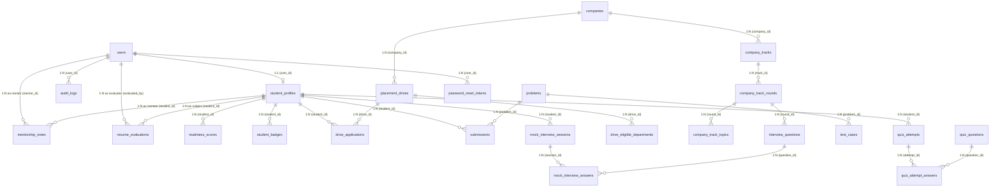

# DATABASE_RELATIONSHIPS.md — MySQL Database Relationships & ERD

> **Database Engine:** MySQL 8.0.45  
> **Database Name:** `placementdb`  
> **Total Foreign Keys:** 22  
> **Verification Status:** Verified Source of Truth

---

## 1. Entity-Relationship Overview

The `placementdb` schema is partitioned into five distinct bounded domains:

1. **Identity & Student Academic Hub:** `users` acts as the root authentication entity. `student_profiles` extends `users` in an exact **1:1 relationship** where `student_profiles.user_id = users.id`. All student-specific domain entities (`readiness_scores`, `drive_applications`, `submissions`, `quiz_attempts`, `mentorship_notes`, `resume_evaluations`, `student_badges`) maintain foreign keys directly to `student_profiles(user_id)`.
2. **Corporate & Campus Recruitment Lifecycle:** `companies` forms a 1:N relationship with `placement_drives` and `company_tracks`. `placement_drives` owns 1:N child records in `drive_eligible_departments` and `drive_applications`.
3. **Coding Assessment Judge Engine:** `problems` maintains a 1:N relationship with `test_cases` and receives 1:N executions recorded in `submissions`.
4. **Company Preparation & Interview Tracks:** `company_tracks` cascades 1:N into `company_track_rounds`, which cascades 1:N into `company_track_topics` and `interview_questions`.
5. **Quiz Engine & Faculty Governance:** `quiz_questions` links 1:N to `quiz_attempt_answers`. `quiz_attempts` represents candidate test sessions. `mentorship_notes` joins mentors (`users`) with students (`student_profiles`). `audit_logs` provides non-blocking administrative tracking (`ON DELETE SET NULL`).

---

## 2. Mermaid Entity-Relationship Diagram

---

## 3. Complete Foreign Key Constraints Reference

Below are all 26 verified foreign key constraints as defined in MySQL `information_schema.REFERENTIAL_CONSTRAINTS`:

| # | Constraint Name | Child Table | Child Column | Parent Table | Parent Column | ON DELETE | ON UPDATE |
|:---:|---|---|---|---|---|:---:|:---:|
| 1 | `fk_student_user` | `student_profiles` | `user_id` | `users` | `id` | **CASCADE** | NO ACTION |
| 2 | `fk_readiness_student` | `readiness_scores` | `student_id` | `student_profiles` | `user_id` | **CASCADE** | NO ACTION |
| 3 | `fk_drive_company` | `placement_drives` | `company_id` | `companies` | `id` | **NO ACTION** | NO ACTION |
| 4 | `fk_eligible_drive` | `drive_eligible_departments` | `drive_id` | `placement_drives` | `id` | **CASCADE** | NO ACTION |
| 5 | `fk_application_student` | `drive_applications` | `student_id` | `student_profiles` | `user_id` | **CASCADE** | NO ACTION |
| 6 | `fk_application_drive` | `drive_applications` | `drive_id` | `placement_drives` | `id` | **CASCADE** | NO ACTION |
| 7 | `fk_testcase_problem` | `test_cases` | `problem_id` | `problems` | `id` | **CASCADE** | NO ACTION |
| 8 | `fk_submission_student` | `submissions` | `student_id` | `student_profiles` | `user_id` | **CASCADE** | NO ACTION |
| 9 | `fk_submission_problem` | `submissions` | `problem_id` | `problems` | `id` | **CASCADE** | NO ACTION |
| 10 | `fk_track_company` | `company_tracks` | `company_id` | `companies` | `id` | **CASCADE** | NO ACTION |
| 11 | `fk_round_track` | `company_track_rounds` | `track_id` | `company_tracks` | `id` | **CASCADE** | NO ACTION |
| 12 | `fk_topic_round` | `company_track_topics` | `round_id` | `company_track_rounds` | `id` | **CASCADE** | NO ACTION |
| 13 | `fk_question_round` | `interview_questions` | `round_id` | `company_track_rounds` | `id` | **CASCADE** | NO ACTION |
| 14 | `fk_quiz_attempt_student` | `quiz_attempts` | `student_id` | `student_profiles` | `user_id` | **CASCADE** | NO ACTION |
| 15 | `fk_answer_attempt` | `quiz_attempt_answers` | `attempt_id` | `quiz_attempts` | `id` | **CASCADE** | NO ACTION |
| 16 | `fk_answer_question` | `quiz_attempt_answers` | `question_id` | `quiz_questions` | `id` | **NO ACTION** | NO ACTION |
| 17 | `fk_note_mentor` | `mentorship_notes` | `mentor_id` | `users` | `id` | **NO ACTION** | NO ACTION |
| 18 | `fk_note_student` | `mentorship_notes` | `student_id` | `student_profiles` | `user_id` | **CASCADE** | NO ACTION |
| 19 | `fk_resume_student` | `resume_evaluations` | `student_id` | `student_profiles` | `user_id` | **CASCADE** | NO ACTION |
| 20 | `fk_resume_evaluator` | `resume_evaluations` | `evaluated_by` | `users` | `id` | **SET NULL** | NO ACTION |
| 21 | `fk_badge_student` | `student_badges` | `student_id` | `student_profiles` | `user_id` | **CASCADE** | NO ACTION |
| 22 | `fk_audit_user` | `audit_logs` | `user_id` | `users` | `id` | **SET NULL** | NO ACTION |
| 23 | `fk_interview_session_student` | `mock_interview_sessions` | `student_id` | `student_profiles` | `user_id` | **RESTRICT** | NO ACTION |
| 24 | `fk_interview_answer_session` | `mock_interview_answers` | `session_id` | `mock_interview_sessions` | `id` | **CASCADE** | NO ACTION |
| 25 | `fk_interview_answer_question` | `mock_interview_answers` | `question_id` | `interview_questions` | `id` | **RESTRICT** | NO ACTION |
| 26 | `fk_reset_token_user` | `password_reset_tokens` | `user_id` | `users` | `id` | **CASCADE** | NO ACTION |

---

## 4. Key Relational Patterns & Architectural Rules

### Rule A: Student vs. User Distinction
- **`users`** represents institutional security principals (`STUDENT`, `MENTOR`, `TPO`).
- **`student_profiles`** represents students enrolled in placement tracking.
- Entities that track student academic activities (`submissions`, `readiness_scores`, `drive_applications`, `student_badges`, `quiz_attempts`, `resume_evaluations`) reference **`student_profiles(user_id)`**, NOT `users(id)`.
- If a user with role `MENTOR` or `TPO` is referenced, the foreign key targets `users(id)` directly (e.g. `mentorship_notes.mentor_id`, `resume_evaluations.evaluated_by`, `audit_logs.user_id`).

### Rule B: Cascade Delete Policies
- When a `placement_drives` record is deleted:
  - All linked `drive_eligible_departments` are automatically removed (`CASCADE`).
  - All linked `drive_applications` are automatically removed (`CASCADE`).
  - The parent company in `companies` is **protected** (`NO ACTION`).
- When a `company_tracks` record is deleted:
  - All `company_track_rounds`, `company_track_topics`, and `interview_questions` are recursively deleted (`CASCADE`).
- When a `problems` record is deleted:
  - All associated `test_cases` and `submissions` are deleted (`CASCADE`).
- When a student's profile is deleted:
  - All associated progress metrics (`readiness_scores`, `submissions`, `quiz_attempts`, `student_badges`, `applications`) cascade delete (`CASCADE`).
- Administrative actions preserve governance history:
  - Deleting an author user from `users` **does not delete** `audit_logs` or `resume_evaluations`; instead the foreign key is cleared to `NULL` (`SET NULL`).

